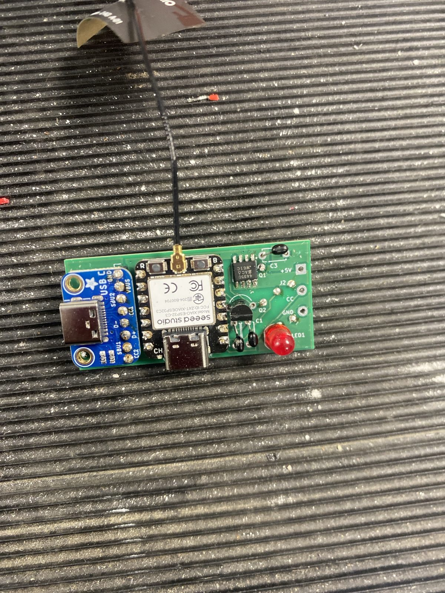
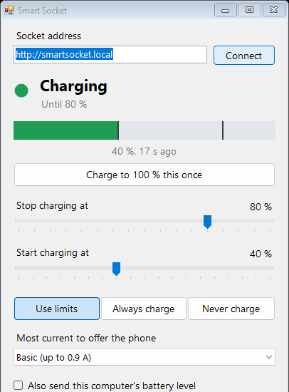
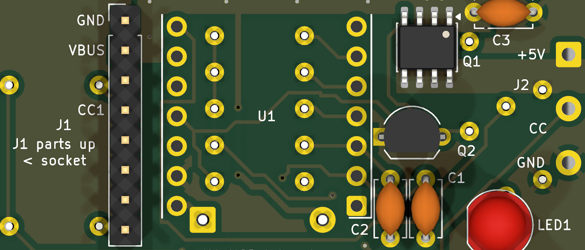
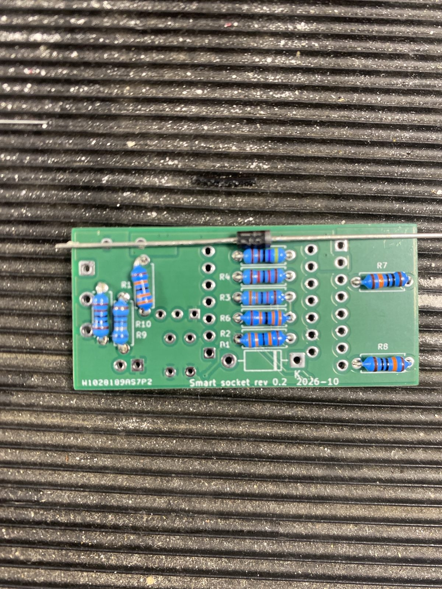
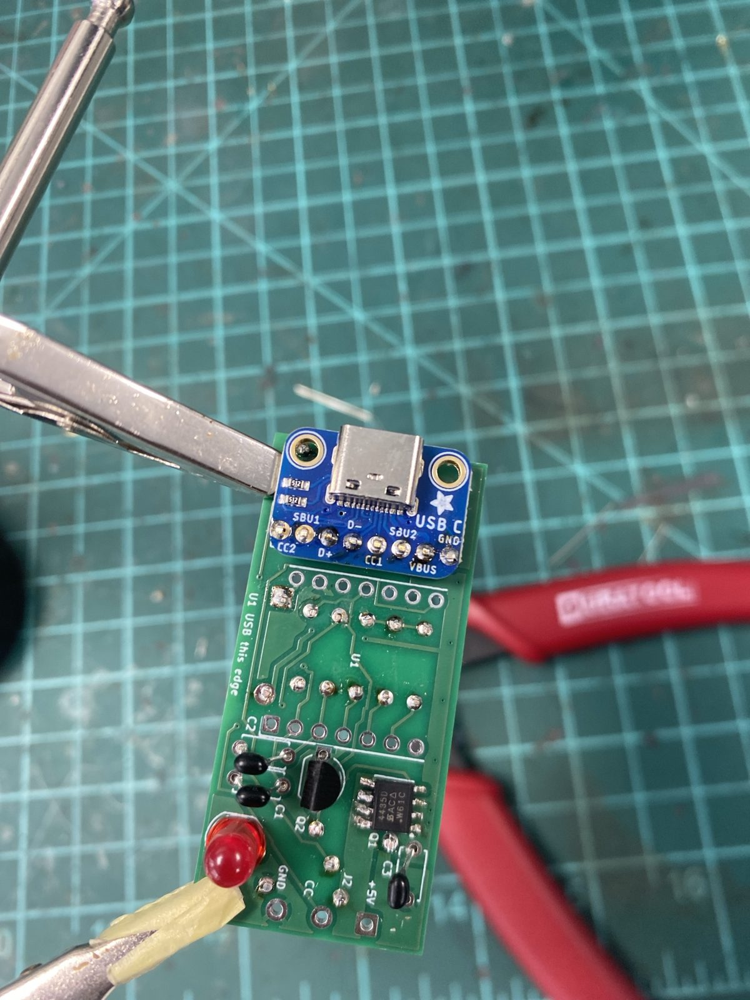
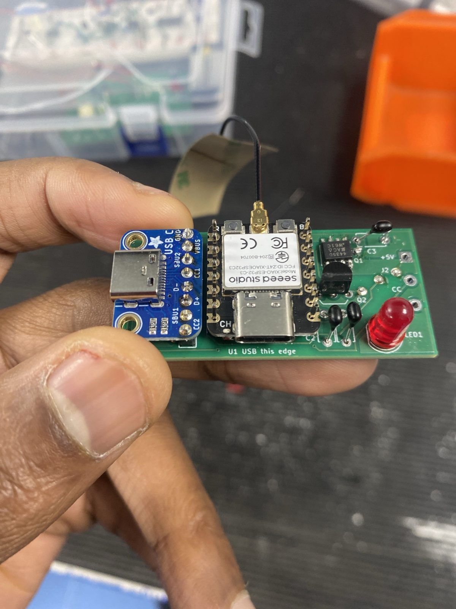

# ESP32-C3 smart USB-C charge controller

A small adapter that sits between a USB-C charger and a phone and stops charging at a battery level you choose, for example 80 %, then starts again at a lower one, for example 40 %. The phone reports its battery level over Wi-Fi, and the adapter does the switching. I designed the circuit and the board, wrote the firmware and the companion apps, and assembled, soldered and tested it in October 2026.

## How it works

To the charger the adapter looks like a simple 5 V device, and to the phone it looks like a simple 5 V charger. Stopping the charge is the same as pulling the plug out, so every phone already knows how to handle it.

- **Power path.** A P channel MOSFET (SI4435) switches the 5 V VBUS line, driven through a 2N7000 by the ESP32-C3. Up to 3 A at 5 V, nothing above 5 V anywhere on the board.
- **USB-C signalling.** The firmware reads the charger's CC pins to learn whether it offers basic current, 1.5 A or 3 A, then advertises the matching limit to the phone by switching one of three CC resistors.
- **Phone detection.** An analog input on the phone side CC line tells the controller whether something is plugged in, even while the output is off.
- **State.** The allowed or stopped state is kept in flash, so it survives a restart. A red LED shows the state, and the BOOT button gives "charge to 100 % once", WPS pairing and a reset.

The full circuit table, pin map and decision rules are in [DESIGN.md](DESIGN.md).

## Firmware

C++ for the Seeed XIAO ESP32-C3 in the Arduino environment ([`firmware/smart_socket/`](firmware/smart_socket)).

- Wireless control over Wi-Fi, with a web page served by the adapter and a JSON API.
- Setup over Bluetooth from the Android app, by WPS, or through a setup network.
- Firmware updates over the air, through Wi-Fi or Bluetooth, with an MD5 check before restarting into the new program.
- Each adapter answers at its own `smartsocket-xxxxxx.local` address, so several can share one network.
- Upper and lower limits, a charge timer, charging hours, a heat cut out and the last 20 charging runs.

The decision rules are mirrored in Python in [`tools/logic.py`](tools/logic.py) and covered by 62 scenario tests. [`tools/test_device.py`](tools/test_device.py) checks a real adapter feature by feature over Wi-Fi.

Before building, copy `firmware/smart_socket/secrets.example.h` to `secrets.h` and set your own update password.

## Apps

- **Android** ([`app-android/`](app-android)): finds every adapter on the network, sets one up over Bluetooth, and reports the phone's battery level in the background.
- **Windows** ([`app-windows/`](app-windows)): every adapter in one list with limits, timer, history and program upload.
- **iPhone**: two Shortcuts automations calling `http://smartsocket.local/api/battery?level=…`, described in [PHONE-SETUP.md](PHONE-SETUP.md).

## Board

Rev 0.2, 51.2 x 24 mm, two layers, made by PCBWay. The charger plugs into one end and the phone cable leaves from the other. Schematic and board are generated by scripts in [`kicad/`](kicad) and checked with ERC, DRC and a netlist comparison.

| | |
|---|---|
|  |  |
|  |  |

A 3D printed case is drafted in OpenSCAD in [`case/`](case).

## Limits of version 1

- 5 V only, up to 15 W. Laptops need 20 V and USB Power Delivery negotiation, which is a job for version 2.
- Charge only: the data wires are not connected.
- Needs a charger with a USB-C socket.

## Tools

ESP32-C3, C++, KiCad, Python, Java for Android, C# for Windows, OpenSCAD.
