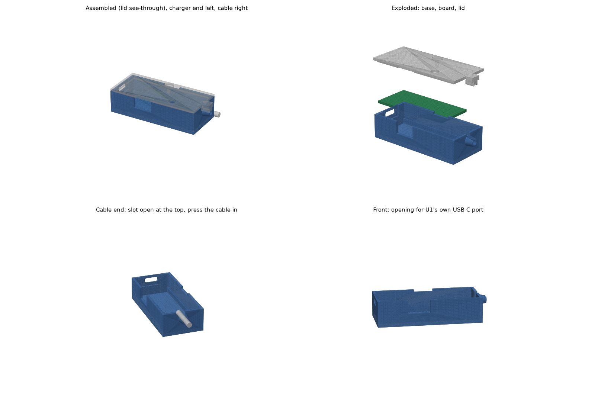

# Smart socket case

Two printed parts, no screws, **no soldering to fit it**. Built by `make_case_stl.py`. (`case.scad` is the
older OpenSCAD draft, kept for reference; the Python file is the one in use.)

| File | What |
|---|---|
| `socket-base.stl` | Base, floor down. 68.8 x 28.0 x 15.6 mm (with the 5 mm cable collar) |
| `socket-lid.stl` | Lid, outer face down as in the file. 68.7 x 28.0 x 5.8 mm |

Closed case 63.8 x 28.0 x 17.2 mm, plus the cable collar.

Built from the measured board (2026-10-28): LED tip 9 mm above the board, blue USB-C board top 4 mm,
cable 3.4 mm.

## Printing

PLA, 0.2 mm layers, 20 % infill, 3 walls, no supports.

## What each opening is

- **Charger end (left):** a socket-shaped hole; the wall is thin there so the plug goes fully in.
- **Cable end (right):** a slot **open at the top**. Lay the cable down into it. A tongue under the lid
  closes the slot and presses on the cable, so pulling the cable doesn't pull on the solder joints.
  Nothing has to be threaded, so nothing is ever unsoldered.
- **Front:** an opening for the XIAO's own USB-C port (USB control from the laptop app, program upload).
- **Lid:** the LED tip sits in a 5 mm hole. The ring marks the BOOT button: press there.
- **Back:** a finger notch to lift the lid off. The lid is a friction fit, so it opens again any time.

## Assembly

1. Drop the board in, charger end first, socket against the hole. It rests on the two rails.
2. Bend the cable so it leaves the board's right end in the middle, and press it down into the slot.
   The wires from J2 curve round in the space past the board.
3. Stick the antenna flat on the **inside of the lid**, between the button ring and the LED hole.
4. Press the lid on: the LED goes into its hole, the tongue into the cable slot.

If the lid is loose, a layer of tape on its lip fixes it; if too tight, sand the lip.

Regenerate: `venv\Scripts\python make_case_stl.py` (numpy, trimesh, manifold3d, matplotlib).
